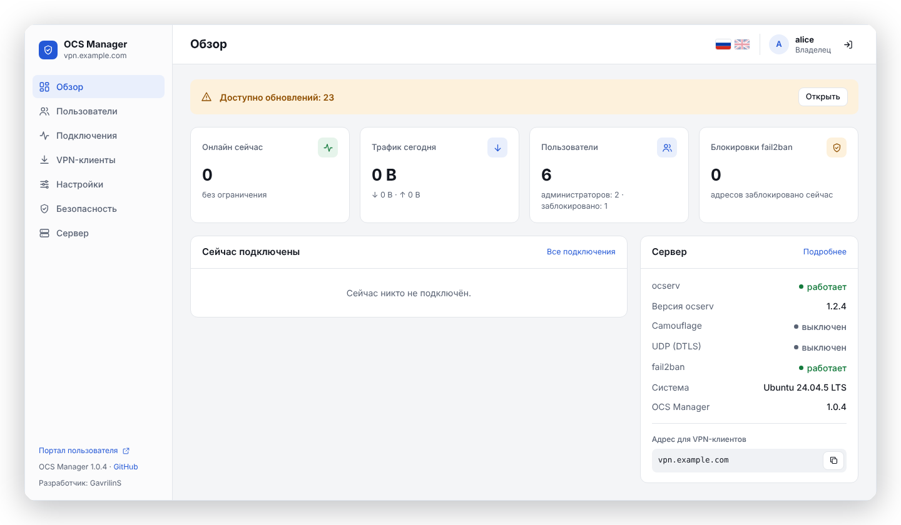
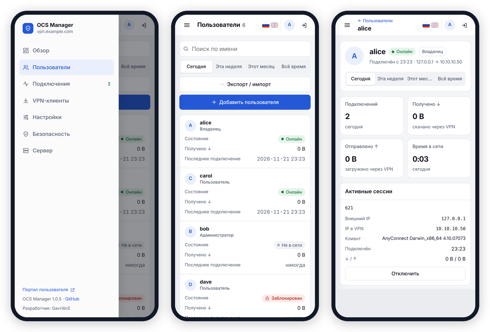
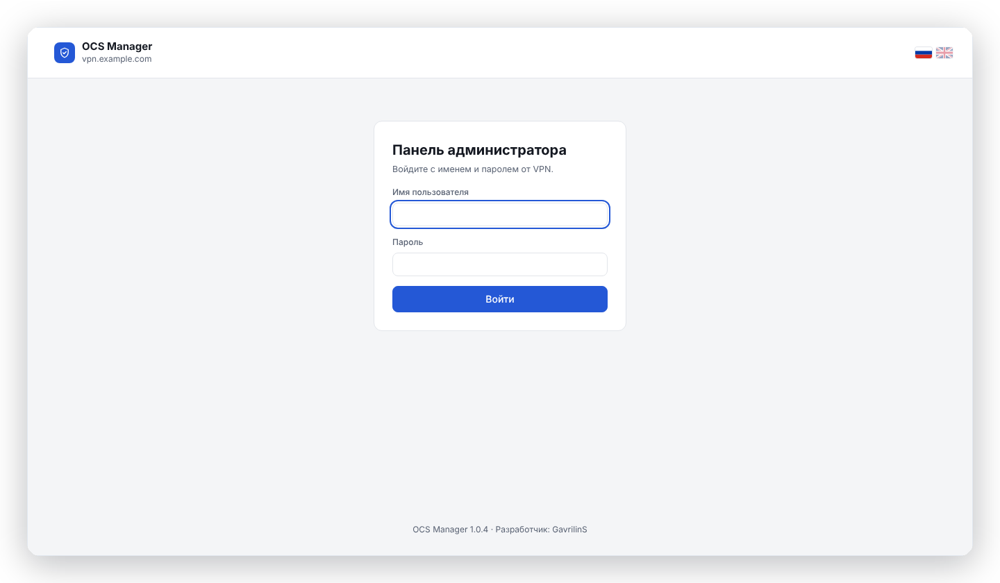
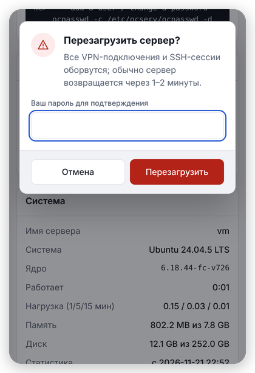
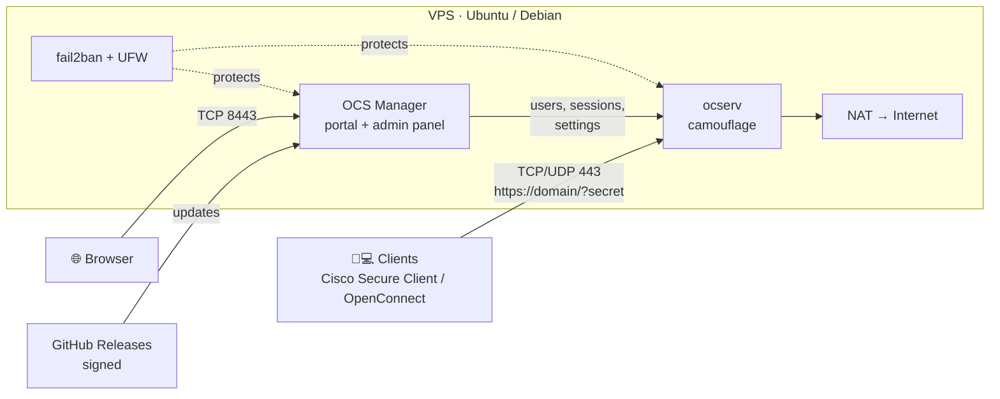

<div align="center">

# 🛡️ OCS Manager

**One-script OpenConnect VPN server (ocserv) with a web control panel**

[](https://github.com/StasGUN/ocsmanager/releases/latest)
[](LICENSE)
[](#requirements)
[](#requirements)
[](#verify)

**English** · [Русский](README.ru.md)

[Quick start](#quick-start) · [Screenshots](#screenshots) · [Beginner's guide](docs/QUICKSTART.md) · [Features](#features) · [Options](#options) · [Changelog](CHANGELOG.md)

</div>

<p align="center">
  
</p>

---

OCS Manager turns a fresh VPS into a ready-to-use VPN server in about ten minutes.
It builds [ocserv](https://ocserv.openconnect-vpn.net/) from source, sets up the
firewall, NAT, a TLS certificate and brute-force protection, and installs a web
panel where you manage users without touching the command line.

Clients connect with **Cisco Secure Client (AnyConnect)** or **OpenConnect** on
Windows, macOS, Linux, iOS and Android.

<a id="features"></a>

## ✨ Features

| | |
|---|---|
| 🔧 **ocserv from source** | Fresh upstream version, Cisco AnyConnect / Secure Client compatible, TCP + UDP (DTLS) on port 443 |
| 🥷 **Camouflage mode** | Without the secret in the URL the server looks like an ordinary web server to scanners and browsers |
| 🔒 **Certificates** | Let's Encrypt with auto-renewal, or self-signed |
| 🧱 **Firewall & NAT** | UFW with auto-detected SSH ports, MASQUERADE and forwarding for VPN clients |
| 🚫 **fail2ban** | Protects SSH, ocserv and the panel; bans via UFW, whitelist and ban settings in the panel |
| 🌐 **User portal** | `https://<domain>:8443/` — users sign in and download the right VPN client for their OS |
| 📊 **Admin panel** | Users and administrators, traffic statistics, connection history, active sessions, ocserv settings |
| 🔄 **Maintenance from the browser** | OS updates, server reboot, panel and ocserv updates from signed GitHub releases |
| ↩️ **Safe updates** | Signature check, settings backup, automatic rollback on failure, manual rollback to the previous version |
| 🌍 **Two languages** | Panel interface in English and Russian |
| ♻️ **Safe to re-run** | Configs are backed up, NAT rules are replaced (not duplicated), panel settings survive re-runs |

<a id="screenshots"></a>

## 📸 Screenshots

The panel works on a phone just as well as on a desktop:

<p align="center">
  
</p>

<details>
<summary><b>More screenshots</b></summary>
<br>

| Sign-in | Dangerous actions need your password |
|:---:|:---:|
|  |  |

</details>

> The interface is available in English and Russian; the screenshots show the Russian version.

<a id="how-it-works"></a>

## 🧭 How it works



<a id="requirements"></a>

## 📋 Requirements

- A VPS with **Ubuntu 22.04 / 24.04+** or **Debian 11 / 12 / 13** and `root` access
- **TUN/TAP** enabled (some OpenVZ/LXC plans need it switched on in the hosting panel)
- At least **700 MB** of free disk space, **400 MB+** RAM recommended (ocserv is compiled on the server)
- Free port **443** (TCP and UDP); port **80** for Let's Encrypt
- A domain name pointing to the server (an `A` record) — recommended, required for Let's Encrypt

<a id="quick-start"></a>

## 🚀 Quick start

```bash
wget https://github.com/StasGUN/ocsmanager/releases/latest/download/install-ocserv.sh
sudo bash install-ocserv.sh
```

Answer a few questions (domain, VPN user, certificate, camouflage) and wait.
At the end the script prints everything you need: the address for the VPN client,
the password, and links to the portal and the admin panel.

> [!IMPORTANT]
> With camouflage on (the default), clients must connect to
> `https://<domain>/?<secret>`. The plain domain will **not** work.

New to VPS and VPN? Follow the step-by-step **[beginner's guide](docs/QUICKSTART.md)**.

## 🖥️ Web panel

| Address | Who | What |
|---|---|---|
| `https://<domain>:8443/` | VPN users | Sign in with the VPN login, download the client |
| `https://<domain>:8443/portal` | Administrators | Full control panel |

For safety the admin panel opens only **while the VPN is connected**, from private
networks (`192.168.0.0/16`, `172.16.0.0/16`, `10.0.0.0/8`) or from localhost;
everyone else gets `404`. If the VPN is down, use an SSH tunnel:

```bash
ssh -L 8443:localhost:8443 root@<domain>
# then open https://localhost:8443/portal
```

Upload the Cisco Secure Client installers (`.msi`/`.exe` for Windows,
`.pkg`/`.dmg` for macOS) in the panel, and users will get the right one
automatically. On phones, users install Cisco Secure Client from the
App Store or Google Play.

<a id="options"></a>

## ⚙️ Unattended install and options

Every setting can be passed through environment variables; anything missing is
asked for (or defaulted when there is no terminal):

```bash
sudo OC_FQDN=vpn.example.com OC_VPN_NET=10.10.10.0/24 \
     OC_USER=alice OC_PASS='secret' OC_CERT=le OC_LE_EMAIL=me@example.com \
     OC_YES=1 bash install-ocserv.sh
```

<details>
<summary><b>All variables</b></summary>

| Variable | Default | Description |
|---|---|---|
| `OC_FQDN` | — | Server domain name |
| `OC_VPN_NET` | `172.16.28.0/24` | VPN address pool |
| `OC_USER` / `OC_PASS` | — / random | First VPN user and password |
| `OC_CERT` | `self` | `le` (Let's Encrypt) or `self` |
| `OC_LE_EMAIL` | — | E-mail for Let's Encrypt |
| `OC_SSH_PORT` | auto | Extra SSH port to open |
| `OC_CAMOUFLAGE` | `1` | Camouflage mode on/off |
| `OC_CAMO_SECRET` | random | Secret, 5–64 chars `A-Z a-z 0-9 _ -` |
| `OC_CAMO_REALM` | — | Answer strangers with `401` + password prompt instead of `404` |
| `OC_PORTAL` | `1` | Web portal on/off |
| `OC_PORTAL_PORT` | `8443` | Portal TCP port |
| `OC_ADMIN_NETS` | private networks | Where the admin panel opens from (`any` = everywhere) |
| `OC_PORTAL_ADMIN` | first VPN user | Panel administrator |
| `OC_FAIL2BAN` | `1` | Install fail2ban |
| `OC_F2B_IGNOREIP` | — | IPs/networks fail2ban must never ban |
| `OC_UDP` | `1` | UDP/DTLS on port 443 |
| `OC_MAX_CLIENTS` | `128` | Max simultaneous connections (`0` = no limit) |
| `OC_MAX_SAME_CLIENTS` | `2` | Connections per user (`0` = no limit) |
| `OC_DNS` | `8.8.8.8 1.1.1.1` | DNS servers for clients |
| `OC_IDLE_TIMEOUT` | `0` | Disconnect idle clients after N minutes |
| `OC_BANNER` | — | Message shown after connecting |
| `OC_UPDATE_REPO` | `StasGUN/ocsmanager` | Repository with panel releases |
| `OC_YES` | — | `1` = skip the final confirmation |
| `OC_FORCE_BUILD` | — | `1` = rebuild ocserv even if installed |
| `OCSERV_VERSION`, `OCSERV_URL`, `OCSERV_SHA256` | — | Override the ocserv source tarball |

Run `sudo bash install-ocserv.sh --help` for the full reference.
</details>

## 🔄 Updating

**From the panel:** the *OCS Manager* card → **Update the panel**.
The update is verified, settings are backed up, and the panel rolls back
automatically if something goes wrong.

**Over SSH:**

```bash
sudo bash install-ocserv.sh --upgrade
```

`--upgrade` asks no questions, leaves OS packages alone and reuses all settings
from `/etc/ocserv/installer.env`.

<a id="verify"></a>

## 🔏 Verifying a release

Every release archive and the installer are signed with an SSH key listed in
[`keys/release-signers`](keys/release-signers). Servers install only signed
archives. To check manually:

```bash
wget https://github.com/StasGUN/ocsmanager/releases/latest/download/install-ocserv.sh.sig
wget https://raw.githubusercontent.com/StasGUN/ocsmanager/main/keys/release-signers
ssh-keygen -Y verify -f release-signers -I ocsmanager -n ocsmanager-release \
           -s install-ocserv.sh.sig < install-ocserv.sh
```

## 🧰 Useful commands

```bash
occtl show users                              # active connections
occtl disconnect user <name>                  # drop a user's sessions
ocpasswd -c /etc/ocserv/ocpasswd <name>       # add a user / change a password
ocpasswd -c /etc/ocserv/ocpasswd -d <name>    # delete a user
systemctl restart ocserv                      # apply ocserv.conf changes
journalctl -u ocserv -f                       # VPN live log
journalctl -u ocserv-portal -f                # panel live log
fail2ban-client status ocserv                 # banned IPs
fail2ban-client set ocserv unbanip <IP>       # unban an address
```

| Path | What |
|---|---|
| `/etc/ocserv/ocserv.conf` | ocserv configuration |
| `/etc/ocserv/installer.env` | Saved installer settings |
| `/var/log/ocserv-install-<date>.log` | Install log |
| `/var/backups/ocsmanager` | Backups made before updates |

## 📄 License

[GNU GPL v3](LICENSE)
