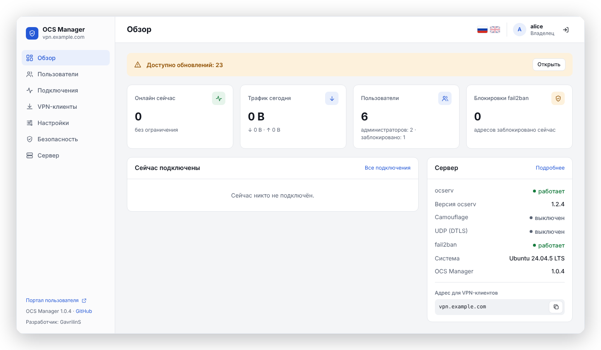
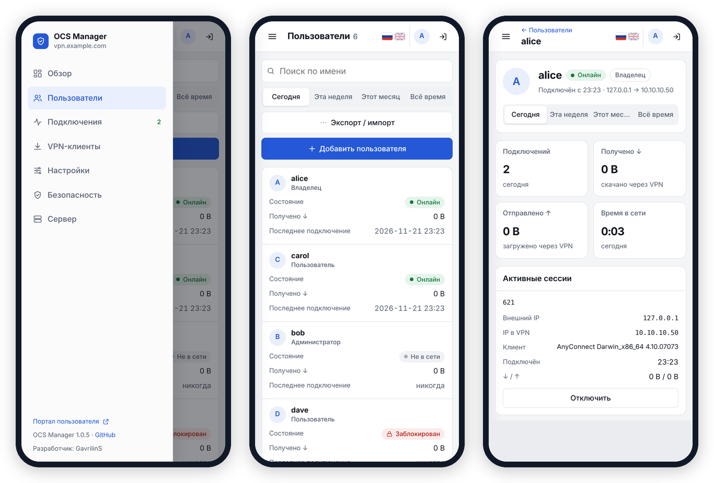
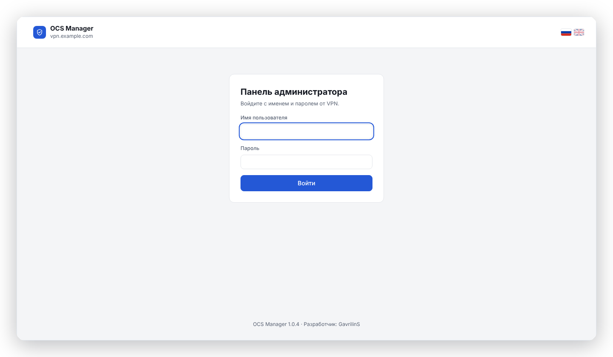
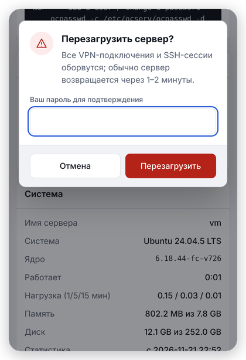
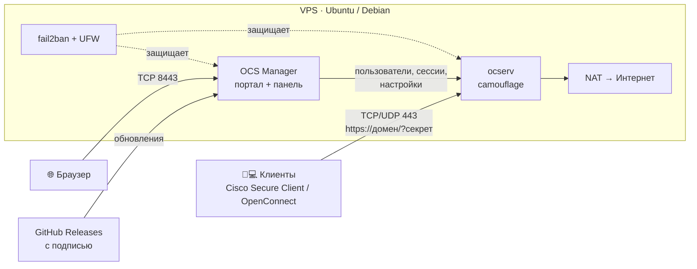

<div align="center">

# 🛡️ OCS Manager

**VPN-сервер OpenConnect (ocserv) с веб-панелью управления — одним скриптом**

[](https://github.com/StasGUN/ocsmanager/releases/latest)
[](LICENSE)
[](#requirements)
[](#requirements)
[](#verify)

[English](README.md) · **Русский**

[Быстрый старт](#quick-start) · [Скриншоты](#screenshots) · [Инструкция для новичков](docs/QUICKSTART.ru.md) · [Возможности](#features) · [Параметры](#options) · [Изменения](CHANGELOG.md)

</div>

<p align="center">
  
</p>

---

OCS Manager превращает чистый VPS в готовый VPN-сервер примерно за десять минут.
Скрипт собирает [ocserv](https://ocserv.openconnect-vpn.net/) из исходников,
настраивает файрвол, NAT, TLS-сертификат и защиту от подбора паролей, а также
ставит веб-панель, в которой пользователями можно управлять без командной строки.

Подключаться можно через **Cisco Secure Client (AnyConnect)** или **OpenConnect**
на Windows, macOS, Linux, iOS и Android.

<a id="features"></a>

## ✨ Возможности

| | |
|---|---|
| 🔧 **ocserv из исходников** | Свежая версия, совместимость с Cisco AnyConnect / Secure Client, TCP + UDP (DTLS) на порту 443 |
| 🥷 **Режим camouflage** | Без секрета в адресе сервер выглядит для сканеров и браузеров как обычный веб-сайт |
| 🔒 **Сертификаты** | Let's Encrypt с автопродлением или самоподписанный |
| 🧱 **Файрвол и NAT** | UFW с автоопределением портов SSH, MASQUERADE и форвардинг для VPN-клиентов |
| 🚫 **fail2ban** | Защита SSH, ocserv и панели; баны через UFW, белый список и настройки банов в панели |
| 🌐 **Портал для пользователей** | `https://<домен>:8443/` — вход и скачивание VPN-клиента под свою ОС |
| 📊 **Панель администратора** | Пользователи и администраторы, статистика трафика, история подключений, активные сессии, настройки ocserv |
| 🔄 **Обслуживание из браузера** | Обновление ОС, перезагрузка сервера, обновление панели и ocserv из подписанных релизов GitHub |
| ↩️ **Безопасные обновления** | Проверка подписи, резервная копия настроек, автоматический откат при сбое, ручной откат на прошлую версию |
| 🌍 **Два языка** | Интерфейс панели на русском и английском |
| ♻️ **Можно запускать повторно** | Конфиги сохраняются в резервные копии, правила NAT заменяются (не дублируются), настройки из панели сохраняются |

<a id="screenshots"></a>

## 📸 Скриншоты

Панель одинаково удобна и на компьютере, и на телефоне:

<p align="center">
  
</p>

<details>
<summary><b>Ещё скриншоты</b></summary>
<br>

| Вход | Опасные действия подтверждаются паролем |
|:---:|:---:|
|  |  |

</details>

<a id="how-it-works"></a>

## 🧭 Как это устроено



<a id="requirements"></a>

## 📋 Требования

- VPS с **Ubuntu 22.04 / 24.04+** или **Debian 11 / 12 / 13** и доступом `root`
- Включённый **TUN/TAP** (на некоторых тарифах OpenVZ/LXC его надо включить в панели хостинга)
- Не меньше **700 МБ** свободного места на диске, желательно **400 МБ+** ОЗУ (ocserv компилируется на сервере)
- Свободный порт **443** (TCP и UDP); порт **80** — для Let's Encrypt
- Доменное имя, направленное на сервер (запись `A`) — желательно, для Let's Encrypt обязательно

<a id="quick-start"></a>

## 🚀 Быстрый старт

```bash
wget https://github.com/StasGUN/ocsmanager/releases/latest/download/install-ocserv.sh
sudo bash install-ocserv.sh
```

Ответьте на несколько вопросов (домен, VPN-пользователь, сертификат, camouflage)
и подождите. В конце скрипт выведет всё нужное: адрес для VPN-клиента, пароль
и ссылки на портал и панель администратора.

> [!IMPORTANT]
> Если включён camouflage (по умолчанию включён), клиенты должны подключаться
> к адресу `https://<домен>/?<секрет>`. Просто домен работать **не будет**.

Впервые работаете с VPS и VPN? Пройдите пошаговую **[инструкцию для новичков](docs/QUICKSTART.ru.md)**.

## 🖥️ Веб-панель

| Адрес | Для кого | Что там |
|---|---|---|
| `https://<домен>:8443/` | VPN-пользователи | Вход с логином VPN, скачивание клиента |
| `https://<домен>:8443/portal` | Администраторы | Полная панель управления |

Ради безопасности панель администратора открывается только **при подключённом VPN**,
из частных сетей (`192.168.0.0/16`, `172.16.0.0/16`, `10.0.0.0/8`) или с самого
сервера; остальным она отвечает `404`. Если VPN не работает, используйте SSH-туннель:

```bash
ssh -L 8443:localhost:8443 root@<домен>
# затем откройте https://localhost:8443/portal
```

Загрузите в панели установщики Cisco Secure Client (`.msi`/`.exe` для Windows,
`.pkg`/`.dmg` для macOS) — пользователи автоматически получат подходящий.
На телефонах Cisco Secure Client ставится из App Store или Google Play.

<a id="options"></a>

## ⚙️ Установка без вопросов и параметры

Любую настройку можно передать через переменные окружения; недостающие скрипт
спросит (или возьмёт значения по умолчанию, если терминала нет):

```bash
sudo OC_FQDN=vpn.example.com OC_VPN_NET=10.10.10.0/24 \
     OC_USER=alice OC_PASS='secret' OC_CERT=le OC_LE_EMAIL=me@example.com \
     OC_YES=1 bash install-ocserv.sh
```

<details>
<summary><b>Все переменные</b></summary>

| Переменная | По умолчанию | Описание |
|---|---|---|
| `OC_FQDN` | — | Доменное имя сервера |
| `OC_VPN_NET` | `172.16.28.0/24` | Пул адресов VPN |
| `OC_USER` / `OC_PASS` | — / случайный | Первый VPN-пользователь и пароль |
| `OC_CERT` | `self` | `le` (Let's Encrypt) или `self` |
| `OC_LE_EMAIL` | — | E-mail для Let's Encrypt |
| `OC_SSH_PORT` | авто | Дополнительный порт SSH |
| `OC_CAMOUFLAGE` | `1` | Режим camouflage вкл/выкл |
| `OC_CAMO_SECRET` | случайный | Секрет, 5–64 символа `A-Z a-z 0-9 _ -` |
| `OC_CAMO_REALM` | — | Отвечать чужим `401` с запросом пароля вместо `404` |
| `OC_PORTAL` | `1` | Веб-портал вкл/выкл |
| `OC_PORTAL_PORT` | `8443` | TCP-порт портала |
| `OC_ADMIN_NETS` | частные сети | Откуда открывается панель администратора (`any` — отовсюду) |
| `OC_PORTAL_ADMIN` | первый VPN-пользователь | Администратор панели |
| `OC_FAIL2BAN` | `1` | Устанавливать fail2ban |
| `OC_F2B_IGNOREIP` | — | IP/сети, которые fail2ban никогда не банит |
| `OC_UDP` | `1` | UDP/DTLS на порту 443 |
| `OC_MAX_CLIENTS` | `128` | Максимум одновременных подключений (`0` — без ограничений) |
| `OC_MAX_SAME_CLIENTS` | `2` | Подключений на одного пользователя (`0` — без ограничений) |
| `OC_DNS` | `8.8.8.8 1.1.1.1` | DNS-серверы для клиентов |
| `OC_IDLE_TIMEOUT` | `0` | Отключать неактивных клиентов через N минут |
| `OC_BANNER` | — | Сообщение, которое клиент покажет после подключения |
| `OC_UPDATE_REPO` | `StasGUN/ocsmanager` | Репозиторий с релизами панели |
| `OC_YES` | — | `1` — не спрашивать финальное подтверждение |
| `OC_FORCE_BUILD` | — | `1` — пересобрать ocserv, даже если он уже установлен |
| `OCSERV_VERSION`, `OCSERV_URL`, `OCSERV_SHA256` | — | Другой архив исходников ocserv |

Полная справка: `sudo bash install-ocserv.sh --help`.
</details>

## 🔄 Обновление

**Из панели:** карточка «OCS Manager» → **«Обновить панель»**.
Обновление проверяется по подписи, настройки сохраняются в резервную копию,
а при сбое панель автоматически откатывается.

**По SSH:**

```bash
sudo bash install-ocserv.sh --upgrade
```

`--upgrade` ничего не спрашивает, не трогает пакеты ОС и берёт все настройки
из `/etc/ocserv/installer.env`.

<a id="verify"></a>

## 🔏 Проверка подписи релиза

Архивы релизов и установщик подписаны SSH-ключом из
[`keys/release-signers`](keys/release-signers). Серверы ставят только подписанные
архивы. Проверить вручную:

```bash
wget https://github.com/StasGUN/ocsmanager/releases/latest/download/install-ocserv.sh.sig
wget https://raw.githubusercontent.com/StasGUN/ocsmanager/main/keys/release-signers
ssh-keygen -Y verify -f release-signers -I ocsmanager -n ocsmanager-release \
           -s install-ocserv.sh.sig < install-ocserv.sh
```

## 🧰 Полезные команды

```bash
occtl show users                              # активные подключения
occtl disconnect user <имя>                   # отключить сессии пользователя
ocpasswd -c /etc/ocserv/ocpasswd <имя>        # добавить пользователя / сменить пароль
ocpasswd -c /etc/ocserv/ocpasswd -d <имя>     # удалить пользователя
systemctl restart ocserv                      # применить изменения ocserv.conf
journalctl -u ocserv -f                       # журнал VPN в реальном времени
journalctl -u ocserv-portal -f                # журнал панели
fail2ban-client status ocserv                 # заблокированные IP
fail2ban-client set ocserv unbanip <IP>       # разблокировать адрес
```

| Путь | Что это |
|---|---|
| `/etc/ocserv/ocserv.conf` | Конфигурация ocserv |
| `/etc/ocserv/installer.env` | Сохранённые настройки установщика |
| `/var/log/ocserv-install-<дата>.log` | Журнал установки |
| `/var/backups/ocsmanager` | Резервные копии перед обновлениями |

## 📄 Лицензия

[GNU GPL v3](LICENSE)
